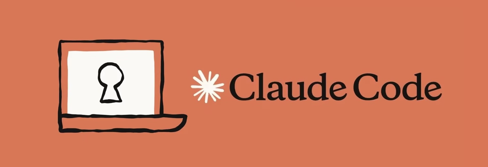

<div align="center">



# Claude Code pour les Dev & DevOps

**Formation pratique à l'ingénierie assistée par agent — développeurs .NET · ingénieurs DevOps**

[](#programme-4-jours)
[](modules/)
[](labs/)
[](https://code.claude.com/docs)
[](ecommerce-app/)
[](#)

*Du prompt jeté au toolkit d'équipe versionné : commandes, mémoire, hooks, skills, plugins,
sous-agents et MCP — chacun introduit au moment où la brique précédente atteint sa limite, sur
une vraie application microservices, avec les garde-fous d'un environnement bancaire.*

</div>

---

## En une minute

Claude Code est un **agent de coding qui vit dans votre terminal** : il lit votre dépôt, édite
des fichiers, exécute `dotnet test`, `docker build` ou `kubectl`, observe le résultat et corrige.

Pour une équipe, l'enjeu n'est pas d'écrire du code plus vite. C'est de **transformer ses façons
de travailler en actifs exécutables et partagés** : une convention devient une ligne de
`CLAUDE.md`, un prompt de revue une **commande**, un garde-fou un **hook**, une procédure de
migration un **skill**, le tout un **plugin** installé en une commande ; un relecteur indépendant
devient un **sous-agent**, et la base, le navigateur ou les traces deviennent visibles par **MCP**.

```
 commandes → mémoire → commandes perso → HOOKS → SKILLS → PLUGINS → SOUS-AGENTS → MCP
   cadrer    retenir     rejouer         imposer  savoir-   partager   déléguer     voir
                                                  faire
```

**Chaque passage est justifié par un cas d'usage réel, côté Dev et côté DevOps** — le fil rouge
de la formation, résumé dans [`docs/choisir-sa-brique.md`](docs/choisir-sa-brique.md). La chaîne
s'arrête au MCP : faire tourner l'agent sans terminal (headless, CI) n'est pas une brique de plus
mais un autre mode d'exécution des mêmes briques — traité en [annexe](modules/annexe-agent-sans-terminal/).

## À qui s'adresse cette formation

**Développeurs** C# / .NET et **ingénieurs DevOps**, y compris débutants sur Claude Code. Les
labs alternent les deux métiers ; deux labs (observabilité, incident) proposent un parcours
propre à chacun, et le capstone se fait en binôme Dev + DevOps.

**Pré-requis réels :** à l'aise avec un terminal, Git, et au moins l'un de : .NET, Docker,
Kubernetes.

## Ce que vous saurez faire à la fin

| # | Compétence | Validée par |
|---|---|---|
| 1 | Piloter une session et la cadrer (`/plan`, `/rewind`, `/context`, `/code-review`) | [Module 01](modules/01-commandes-natives/) |
| 2 | Donner au projet une mémoire vérifiable (`CLAUDE.md`, `@ ! #`) | [Module 02](modules/02-contexte-et-memoire/) · [Lab 01](labs/lab-01-git-github/) |
| 3 | Capitaliser les prompts d'équipe en **commandes** | [Module 03](modules/03-commandes-personnalisees/) |
| 4 | Imposer des **garde-fous déterministes** (secrets, destructif, migrations, tests rouges, audit) | [Module 04](modules/04-hooks/) · [Labs 02-03](labs/lab-03-securite-secrets/) |
| 5 | Écrire des **skills** avec fichiers d'appui, et contrôler qui les déclenche | [Module 05](modules/05-skills/) · [Lab 04](labs/lab-04-postgresql/) |
| 6 | **Consommer, produire, distribuer et gouverner des plugins** (LSP, bundle, marketplace interne) | [Module 06](modules/06-plugins/) |
| 7 | Déléguer à des **sous-agents** indépendants, restreints, en parallèle | [Module 07](modules/07-sous-agents/) · [Labs 08, 11](labs/lab-11-incident-postmortem/) |
| 8 | Brancher l'agent sur la base, le navigateur, la forge et la télémétrie **en lecture seule** — MCP intégrés, officiels et internes | [Module 08](modules/08-mcp/) · [Labs 04, 05, 10](labs/lab-10-observabilite/) |
| 9 | Faire tourner l'agent **sans humain** en CI, sans lui laisser de décision | [Annexe](modules/annexe-agent-sans-terminal/) · [Lab 06](labs/lab-06-ci-cd/) |
| 10 | Livrer une fonctionnalité de la migration au cluster observé, et tenir un incident | [Capstone](labs/capstone/) |

---

## Démarrage rapide

```bash
# 1. Installer Claude Code (macOS / Linux / WSL)
curl -fsSL https://claude.ai/install.sh | bash
claude --version && claude doctor

# 2. Vérifier le poste
./docs/check-prereqs.sh

# 3. Travailler sur une copie de l'application fil rouge
export FORMATION="$PWD"
cp -r ecommerce-app ~/lab-ecommerce && cd ~/lab-ecommerce
claude
```

Puis enchaînez sur le **[Module 00 — Prise en main](modules/00-prise-en-main/)**.

---

## Structure du dépôt

```
dev-devops-claude-code/
├── README.md · CLAUDE.md
├── docs/                      ← choisir-sa-brique, garde-fous, cheat-sheet, glossaire, prérequis
├── tp/                        ← J1 : TP de prompt engineering (Markdown, 13 techniques)
├── slides/                    ← 4 decks PDF (sources : ../dev-devops-claude-code_latex/)
├── modules/                   ← 9 modules, une brique chacun (00 → 08) + une annexe hors chaîne
├── labs/                      ← 11 labs + capstone, corrigés dans solution/
├── plugins/
│   ├── oddo-dev-toolkit/      ← le plugin d'équipe : commandes, skills, sous-agents, hooks
│   └── oddo-dev-standard/     ← plugin « bundle » : le poste standard en une commande
├── .claude-plugin/
│   └── marketplace.json       ← le marketplace interne de la formation
└── ecommerce-app/             ← application fil rouge, livrée nue (sans .claude/, sans CI)
```

| Document | Contenu | Quand le lire |
|---|---|---|
| [`docs/choisir-sa-brique.md`](docs/choisir-sa-brique.md) | Chaque transition de brique et son cas d'usage ; arbre de décision | **Le fil rouge** — à relire à chaque module |
| [`docs/prerequis.md`](docs/prerequis.md) · [`check-prereqs.sh`](docs/check-prereqs.sh) | Installation et vérification du poste | Avant J1 |
| [`docs/garde-fous.md`](docs/garde-fous.md) | Les six règles du cadre bancaire et leur mise en œuvre | Ouverture J1, avant le capstone |
| [`docs/cheatsheet.md`](docs/cheatsheet.md) | Commandes, préfixes, plugins, MCP | À garder ouvert |
| [`docs/glossaire.md`](docs/glossaire.md) | Le vocabulaire, pour un profil Dev ou DevOps | Dès qu'un terme accroche |
| [`slides/`](slides/) | Les quatre decks : plan, fondations & prompting, les briques, les labs | Projetés pendant la formation |

---

## Les 9 modules — et une annexe

| # | Module | La limite qui la justifie | Durée |
|:---:|---|---|:---:|
| 00 | [Prise en main](modules/00-prise-en-main/) | « Que voit-il, que fait-il sans me demander ? » | 45 min |
| 01 | [Commandes natives](modules/01-commandes-natives/) | « Je ne sais ni l'arrêter, ni annuler, ni voir ce qu'il a en tête. » | 45 min |
| 02 | [Contexte & mémoire](modules/02-contexte-et-memoire/) | « Il ignore nos conventions à chaque session. » | 40 min |
| 03 | [Commandes personnalisées](modules/03-commandes-personnalisees/) | « Je retape le même prompt de revue tous les jours. » | 30 min |
| 04 | [Hooks](modules/04-hooks/) | « Ma commande *dit* de ne pas committer de secret ; rien ne l'*empêche*. » | 50 min |
| 05 | [Skills](modules/05-skills/) | « Un hook sait dire non, pas *faire* une procédure. » | 45 min |
| 06 | [Plugins](modules/06-plugins/) | « Douze collègues, huit dépôts — et je réinvente ce qui existe. » | 60 min |
| 07 | [Sous-agents](modules/07-sous-agents/) | « La revue sature ma session et valide par complaisance. » | 45 min |
| 08 | [MCP](modules/08-mcp/) | « Il ne voit ni la base, ni le navigateur, ni les traces. » | 60 min |
| *A* | *[Annexe — l'agent sans terminal](modules/annexe-agent-sans-terminal/)* | *Hors chaîne : un mode d'exécution (`claude -p`, `/loop`), pas une brique* | *40 min* |

## Les 11 labs

| Lab | Cas d'usage | Livrable |
|:---:|---|---|
| [01](labs/lab-01-git-github/) | **Git & GitHub** | Correctif de validation livré en PR par `/ship` |
| [02](labs/lab-02-tests/) | **Tests** | 9 tests d'intégration ; hook qui interdit de conclure sur du rouge |
| [03](labs/lab-03-securite-secrets/) | **Sécurité & secrets** | Chaîne anti-secret, dépendances corrigées, CI bloquante, poste standard |
| [04](labs/lab-04-postgresql/) | **Base PostgreSQL** ✨ | Schéma, migration relue, Testcontainers, MCP en lecture seule |
| [05](labs/lab-05-frontend/) | **Frontend** ✨ | Filtres, états, accessibilité, page santé — vérifiés dans Chrome |
| [06](labs/lab-06-ci-cd/) | **CI/CD** | CI, CD avec gate, revue headless du diff et du SQL |
| [07](labs/lab-07-docker/) | **Conteneurs** | Images chiselées non-root scannées ; compose avec PostgreSQL |
| [08](labs/lab-08-kubernetes/) | **Kubernetes** | App + base sur k3d, Secret hors fichier, trois pannes diagnostiquées |
| [09](labs/lab-09-helm/) | **Helm** | Chart multi-environnements, rendu relu |
| [10](labs/lab-10-observabilite/) | **Observabilité** — Dev / DevOps | Télémétrie métier + MCP Aspire ; collecte et Grafana + MCP |
| [11](labs/lab-11-incident-postmortem/) | **Incident** — Dev / DevOps | Contrat cassé retrouvé par `git bisect` ; rotation de Secret ; post-mortem |
| [🏁](labs/capstone/) | **Capstone** | Une fonctionnalité de la migration au cluster, épreuve croisée |

---

## Programme 4 jours

| Jour | Matin | Après-midi |
|:---:|---|---|
| **J1** — *Fondations & prise en main* | Fondations IA générative & prompt engineering, [TP](tp/TP_Prompt_Engineering_Dev_DevOps.md) | Modules **00 → 03** : session, commandes natives, mémoire, commandes perso |
| **J2** — *Imposer et capitaliser* | Lab **01** (Git) · Module **04** (hooks) · Module **05** (skills) | Lab **02** (tests) · Module **06** (plugins) · Lab **03** (sécurité) |
| **J3** — *Déléguer, connecter* | Modules **07** (sous-agents) et **08** (MCP) · Lab **04** (PostgreSQL) | Lab **05** (frontend) · **Annexe** (l'agent sans terminal) · Lab **06** (CI/CD) |
| **J4** — *Livrer et exploiter* | Labs **07** (Docker), **08** (Kubernetes), **09** (Helm) | Labs **10** (observabilité), **11** (incident) · **Capstone** et restitution |

**Rythme visé : ≈ 30 % théorie / 70 % pratique.** Modules et labs **alternent** : chaque lab
applique les briques vues et révèle la limite de la suivante. Variables d'ajustement si le groupe
prend du retard : Lab 09 (Helm) et le parcours DevOps du Lab 10.

---

## Application fil rouge

[`ecommerce-app/`](ecommerce-app/) — e-commerce en **microservices .NET 10 / ASP.NET Core**,
orchestré par **.NET Aspire** : `Catalog.Api`, `Ordering.Api` (minimal APIs + EF Core),
`Gateway` (YARP), `Web` (Blazor Server), `ServiceDefaults` (OpenTelemetry, health checks,
résilience). **Livrée nue** : ni `.claude/`, ni tests, ni base réelle, ni Dockerfile, ni CI. Au fil
des labs, elle reçoit une base PostgreSQL, une interface modernisée, des tests, une télémétrie
métier, des images, un chart et une chaîne CI/CD.

```bash
export PATH="/usr/local/share/dotnet:$PATH"
cd ecommerce-app && dotnet build ECommerce.slnx
dotnet run --project src/ECommerce.AppHost       # dashboard Aspire : URL + jeton en console
```

---

## Garde-fous & conformité

Cadre bancaire (DORA, RGPD, secret professionnel) : six règles, **appliquées techniquement**.

| Règle | Mise en œuvre | Où |
|---|---|---|
| R1 — Aucune donnée sensible dans un prompt, un fichier ou un log | Hooks anti-secret (écriture + commit), `deny` en lecture, `user-secrets`, télémétrie sans PII | [Module 04](modules/04-hooks/) · [Lab 03](labs/lab-03-securite-secrets/) |
| R2 — Aucune action destructive sans validation humaine | Hook `guard-destructive` + `deny` | [Module 04](modules/04-hooks/) |
| R3 — Aucun déploiement en production automatique | Environnement protégé côté GitHub | [Lab 06](labs/lab-06-ci-cd/) |
| R4 — Schéma, pipeline et infra relus par un humain | Skill `ef-migration`, `db-reviewer`, hook `guard-migrations`, rendu Helm | [Labs 04, 09](labs/lab-04-postgresql/) |
| R5 — Traçabilité des actions de l'agent | Hook `audit-log`, hors dépôt | [Lab 03](labs/lab-03-securite-secrets/) |
| R6 — Une donnée externe n'est pas une instruction | MCP en lecture seule : rôle SQL, jetons fine-grained, *Viewer* | [Module 08](modules/08-mcp/) |

> **Le principe :** *l'IA propose, l'ingénieur décide et vérifie.* Un hook n'est pas un modèle :
> il s'exécute toujours. Détail : [docs/garde-fous.md](docs/garde-fous.md).

---

## Ce qui a été vérifié

Les corrigés de code ont été **exécutés** en écrivant la formation : build sans avertissement,
tests (dont 9 contre un vrai PostgreSQL via Testcontainers), application complète lancée par
Aspire et interrogée via la gateway, pile `docker compose` avec PostgreSQL, serveur MCP DBHub en
lecture seule (écriture refusée par trois barrières), serveur MCP C# interrogé en stdio, hooks
testés sur leurs cas positifs et négatifs, plugins validés en mode strict et installés (bundle
compris) dans une configuration isolée. Les manifestes Kubernetes et le chart Helm sont validés par
schéma (`kubeconform`, `helm lint`), sans exécution sur cluster. Chaque énoncé précise ce qui a été
vérifié pour son corrigé.

---

## Conventions du dépôt

- **`modules/NN-nom/`** — une brique : limite, concept, anatomie, mini-lab, erreurs, checklist, limite suivante.
- **`labs/lab-NN-nom/`** — un cas d'usage ; **`solution/`** — le corrigé, cumulatif.
- **`ecommerce-app/`** — jamais modifiée dans le dépôt de formation : on travaille sur une copie.
- Contenu pédagogique en **français** ; code, identifiants et configuration en **anglais**.

## Dépannage

| Symptôme | Cause probable | Solution |
|---|---|---|
| `claude: command not found` | Binaire hors du `PATH` | `export PATH="$HOME/.local/bin:$PATH"` |
| `dotnet: command not found` | SDK hors du `PATH` | `export PATH="/usr/local/share/dotnet:$PATH"` |
| Un hook ne se déclenche jamais | Script non exécutable, `matcher` erroné | `chmod +x`, puis `/hooks` |
| Un hook s'exécute deux fois | Déclaré dans le projet **et** dans un plugin | Une seule source |
| Plugin LSP sans effet | Binaire du serveur de langage absent | `dotnet tool install --global csharp-ls`, onglet *Errors* de `/plugin` |
| Serveur MCP en échec | Variable d'environnement absente, version non trouvée | `/mcp`, `claude mcp get <nom>` |
| Dashboard Aspire en `UntrustedRoot` | Certificat de développement non approuvé | `dotnet dev-certs https --trust` |
| Tests Testcontainers en échec immédiat | Docker arrêté | Démarrer Docker |

---

## Auteur & licence

**Bassem Ben Hamed** — formation IA générative & ingénierie assistée par agent.

© 2026 — usage interne ODDO BHF. Reproduction hors du cadre de la formation soumise à autorisation.
